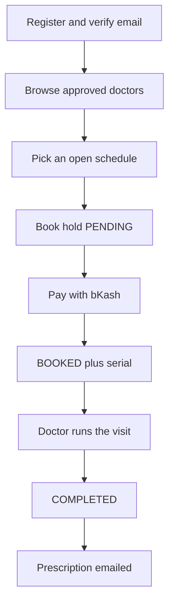
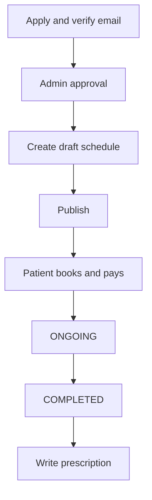
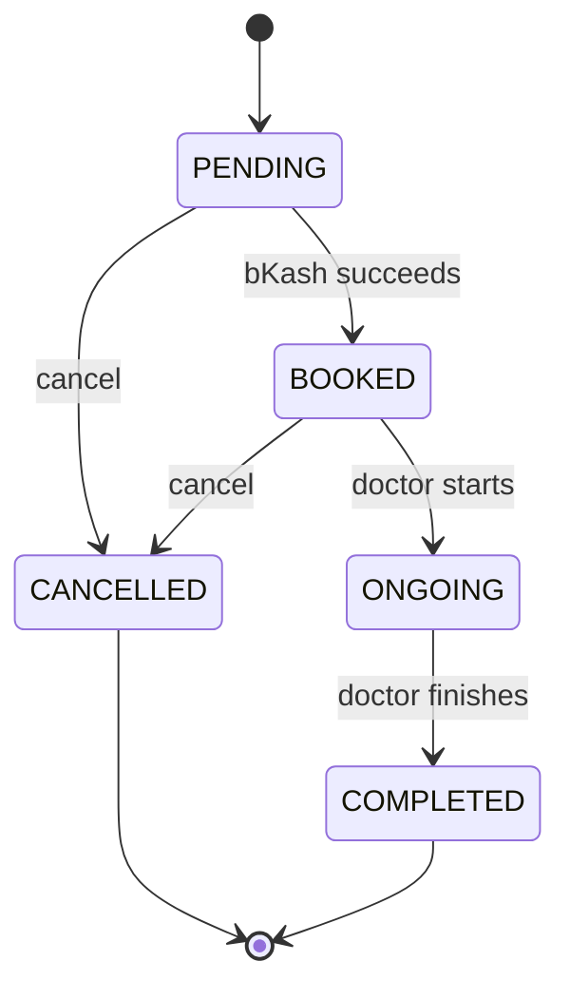

# PH Healthcare — API Design & Documentation

A backend API for same-day clinic visits. Patients find an approved doctor, book a published schedule, pay the consultation fee with bKash, and receive a 20-minute serial. Doctors publish hours and write prescriptions. Admins and super admins approve doctors and manage accounts.

Live API: `https://ph-healthcare-api.vercel.app`  
Local API: `http://localhost:5000`  
Feature routes use the prefix `/api/v1`.

## Table of Contents

- [1. Project Overview](#1-project-overview)
- [2. Roles & Permissions](#2-roles--permissions)
- [3. Technology Stack](#3-technology-stack)
- [4. Package Manager & Scripts](#4-package-manager--scripts)
- [5. Features](#5-features)
- [6. Standard Response Format](#6-standard-response-format)
- [7. API Endpoints](#7-api-endpoints)
  - [7.1 Root](#71-root)
  - [7.2 Authentication](#72-authentication)
  - [7.3 Users](#73-users)
  - [7.4 Doctors](#74-doctors)
  - [7.5 Schedules](#75-schedules)
  - [7.6 Appointments](#76-appointments)
  - [7.7 Payments](#77-payments)
  - [7.8 Prescriptions](#78-prescriptions)
  - [7.9 Contact](#79-contact)
- [8. Database Tables](#8-database-tables)
- [9. Flow Diagrams](#9-flow-diagrams)

---

## 1. Project Overview

**PH Healthcare** connects patients with approved doctors for same-day visits.

A visitor browses the public doctor directory. A **patient** books an open schedule, pays with bKash, and joins at the assigned serial. A **doctor** publishes hours, runs the visit, and writes a prescription after completion. An **admin** or **super admin** approves doctor applications and manages accounts.

Auth uses httpOnly JWT cookies. Send requests with credentials included.

[⬆ Back to top](#ph-healthcare--api-design--documentation)

---

## 2. Roles & Permissions

| Role | Description | Key permissions |
| --- | --- | --- |
| **PATIENT** | Books and pays for visits | Register · verify email · browse doctors · book · pay · cancel · view payments and prescriptions · update profile |
| **DOCTOR** | Runs published schedules | Apply · verify email · wait for approval · create and publish schedules · start and complete visits · write prescriptions |
| **ADMIN** | Clinic staff | Approve or reject doctors · list patients and admins · block or unblock accounts · view appointments and payments |
| **SUPER_ADMIN** | Full platform control | Everything an admin can do · create admins and super admins · change admin account status |

Patients register on the site. Doctors apply and wait for approval. Admins and super admins are created by staff accounts, not public signup.

[⬆ Back to top](#ph-healthcare--api-design--documentation)

---

## 3. Technology Stack

| Area | Technology | Notes |
| --- | --- | --- |
| Runtime | Node.js | Dev via `tsx watch`; production runs `dist/server.js`. |
| Language | TypeScript | Strict typing across modules. |
| Web framework | Express 5 | Routes mounted from `src/app.ts`. |
| ORM | Prisma 7 (`@prisma/adapter-pg`) | Schema split under `prisma/schema/`. |
| Database | PostgreSQL | Connected through `DATABASE_URL`. |
| Cache / OTP | Redis | Pending registration and password-reset payloads. |
| Auth | JWT + bcryptjs | Access and refresh tokens as httpOnly cookies. |
| Validation | Zod 4 | Request body and query validation. |
| Payments | bKash sandbox | Checkout URL + payment callback. |
| Files | Multer + Cloudinary | Profile photos, doctor resumes, prescription PDFs. |
| Email | Nodemailer | OTP, invoice, and prescription mail. |
| Jobs | node-cron | Unpaid hold cleanup on non-Vercel hosts. |
| Deployment | Vercel | API project `ph-healthcare-api`. |

[⬆ Back to top](#ph-healthcare--api-design--documentation)

---

## 4. Package Manager & Scripts

This project uses **npm**.

| Command | Purpose |
| --- | --- |
| `npm install` | Install dependencies. |
| `npm run dev` | Start the API with live reload (`tsx watch ./src/server.ts`). |
| `npm run build` | Generate Prisma client and bundle with `tsup`. |
| `npm start` | Run the compiled server (`node dist/server.js`). |
| `npm run typecheck` | TypeScript check only. |

[⬆ Back to top](#ph-healthcare--api-design--documentation)

---

## 5. Features

### Public
- Browse approved, active, email-verified doctors
- Filter by specialty, fee, and experience
- View one doctor and open slots
- Contact the clinic
- Patient register and doctor apply (with email OTP)

### Patient
- Book a published schedule (hold starts as `PENDING`)
- Pay the consultation fee with bKash
- Receive a 20-minute serial after payment
- Cancel with refund when more than 1 hour remains before start
- View appointments, payments, and receipts
- Read prescriptions after a completed visit

### Doctor
- Create draft schedules (3–8 hours, one calendar day, 20-minute slots)
- Publish schedules and lock the date
- Move visits `BOOKED → ONGOING → COMPLETED`
- Write one prescription per completed appointment

### Admin / Super admin
- Approve or reject doctor applications
- Create admin accounts (super admin can also create super admins)
- Block or unblock accounts
- View all appointments, schedules, and payments

[⬆ Back to top](#ph-healthcare--api-design--documentation)

---

## 6. Standard Response Format

**Success:**

```json
{
  "success": true,
  "message": "Human-readable description of what happened",
  "data": {},
  "meta": { "page": 1, "limit": 10, "total": 42 }
}
```

`meta` appears on paginated list endpoints. Elsewhere it may be omitted or null.

**Error:**

```json
{
  "success": false,
  "message": "Human-readable description of what went wrong"
}
```

List routes share these query fields unless a row says otherwise:

| Query | Default |
| --- | --- |
| `page` | `1` |
| `limit` | `10` |
| `sortBy` | `createdAt` |
| `sortOrder` | `desc` |

A password must be at least 8 characters and include an uppercase letter, a lowercase letter, a number, and a special character.

[⬆ Back to top](#ph-healthcare--api-design--documentation)

---

## 7. API Endpoints

### 7.1 Root

| Method | Route | Access | Behavior |
| --- | --- | --- | --- |
| GET | `/` | Public | Welcome message. |
| GET | `/test` | Public | Welcome message plus a random 6-digit number. |

[⬆ Back to top](#ph-healthcare--api-design--documentation)

---

### 7.2 Authentication

Mount: `/api/v1/auth`

| Method | Route | Access | Behavior |
| --- | --- | --- | --- |
| POST | `/api/v1/auth/register` | Public | Starts patient registration. JSON body or multipart with optional `profileImage`. Sends email OTP. |
| POST | `/api/v1/auth/verify-email` | Public | Confirms the patient email with a 6-digit OTP. |
| POST | `/api/v1/auth/login` | Public | Signs in and sets auth cookies. |
| GET | `/api/v1/auth/me` | Signed in | Returns the signed-in user. |
| GET | `/api/v1/auth/login` | Signed in | Same as `/auth/me`. |
| POST | `/api/v1/auth/google` | Public | Google sign-in. Creates a patient when the email is new. |
| POST | `/api/v1/auth/facebook` | Public | Facebook sign-in. Stays unused until app credentials exist. |
| POST | `/api/v1/auth/refresh-token` | Refresh cookie | Issues a new access token. |
| POST | `/api/v1/auth/forgot-password` | Public | Emails a reset code. |
| POST | `/api/v1/auth/reset-password` | Public | Sets a new password with that code. |
| POST | `/api/v1/auth/change-password` | Signed in | Changes the current password. |
| POST | `/api/v1/auth/set-password` | Patient | Adds a password after Google sign-in. |
| POST | `/api/v1/auth/logout` | Public | Clears auth cookies. |

**Example — Login**

```json
{
  "email": "patient@example.com",
  "password": "SecurePass1!"
}
```

[⬆ Back to top](#ph-healthcare--api-design--documentation)

---

### 7.3 Users

Mount: `/api/v1/user`

| Method | Route | Access | Behavior |
| --- | --- | --- | --- |
| POST | `/api/v1/user/create-admin` | Admin, Super admin | Creates an admin. Login uses the organization email. |
| POST | `/api/v1/user/create-super-admin` | Super admin | Creates a super admin. |
| PATCH | `/api/v1/user/account-status` | Admin, Super admin | Blocks or unblocks an account (`ACTIVE` / `BLOCKED`). |
| GET | `/api/v1/user/patients` | Admin, Super admin | Lists patients. |
| GET | `/api/v1/user/admins` | Admin, Super admin | Lists admins and super admins. |
| PATCH | `/api/v1/user/profile-image` | Signed in | Uploads a profile photo (`profileImage`). |
| PATCH | `/api/v1/user/my-profile` | Signed in | Updates name, phone, and related profile fields. |

[⬆ Back to top](#ph-healthcare--api-design--documentation)

---

### 7.4 Doctors

Mount: `/api/v1/doctor`

| Method | Route | Access | Behavior |
| --- | --- | --- | --- |
| POST | `/api/v1/doctor/apply-as-doctor` | Public | Multipart doctor application with resume. Sends email OTP. |
| POST | `/api/v1/doctor/apply-as-doctor/verify-email` | Public | Confirms doctor email. Account stays off the public list until approval. |
| POST | `/api/v1/doctor/approve-doctor` | Admin, Super admin | Approves or rejects (`APPROVED` / `REJECTED`). |
| GET | `/api/v1/doctor/all-doctors` | Public | Lists doctors. Guests and patients only see approved, active, verified doctors. |
| GET | `/api/v1/doctor/:doctorId` | Public | One doctor, same visibility rules. |
| PATCH | `/api/v1/doctor/update-my-profile` | Doctor | Updates address, bio, fee, or contact number. |

Doctor list filters: `searchTerm`, `specialization`, `maxFee`, `minExperience`, `sortBy` (`createdAt`, `name`, `consultationFee`, `experienceYears`), `sortOrder`.

[⬆ Back to top](#ph-healthcare--api-design--documentation)

---

### 7.5 Schedules

Mount: `/api/v1/schedule`

A schedule is 3 to 8 hours, stays on one calendar date, and splits into 20-minute slots. It starts as `DRAFT`. The date locks after publish. The time range locks after the first booking.

| Method | Route | Access | Behavior |
| --- | --- | --- | --- |
| POST | `/api/v1/schedule/create-schedule` | Doctor | Creates a draft (`startDateTime`, `endDateTime`, `meetingLink`). |
| GET | `/api/v1/schedule/my-schedules` | Doctor | Lists the signed-in doctor's schedules. |
| GET | `/api/v1/schedule/all-schedules` | Admin, Super admin | Lists schedules. |
| GET | `/api/v1/schedule/todays-schedule` | Public | Published schedules for today that still have an open slot. |
| GET | `/api/v1/schedule/future-schedules` | Public | Upcoming published schedules with open slots. |
| GET | `/api/v1/schedule/open-slots/:doctorId` | Public | Open slots for one doctor. |
| PATCH | `/api/v1/schedule/update-schedule/:scheduleId` | Doctor | Updates a schedule the doctor owns. |
| PATCH | `/api/v1/schedule/publish-schedule/:scheduleId` | Doctor | Publishes a draft. |
| GET | `/api/v1/schedule/:scheduleId` | Doctor, Admin, Super admin | One schedule. |
| DELETE | `/api/v1/schedule/:scheduleId` | Doctor | Deletes a schedule the doctor owns. |

[⬆ Back to top](#ph-healthcare--api-design--documentation)

---

### 7.6 Appointments

Mount: `/api/v1/appointment`

Booking starts as `PENDING` and becomes `BOOKED` after bKash succeeds. Cancel more than 1 hour before the start for a refund.

| Method | Route | Access | Behavior |
| --- | --- | --- | --- |
| POST | `/api/v1/appointment/book-appointment` | Patient | Holds a slot (`scheduleId`). |
| POST | `/api/v1/appointment/pay-appointment` | Patient | Opens the bKash payment page. |
| GET | `/api/v1/appointment/book-appointment/payment/callback` | bKash redirect | Confirms payment, assigns the serial, emails the invoice. |
| POST | `/api/v1/appointment/cancel-appointment` | Patient, Admin, Super admin | Cancels the visit. |
| PATCH | `/api/v1/appointment/update-status/:appointmentId` | Doctor | Moves status to `ONGOING` or `COMPLETED`. |
| GET | `/api/v1/appointment/my-appointments` | Patient | The signed-in patient's visits. |
| GET | `/api/v1/appointment/doctor-appointments` | Doctor | The signed-in doctor's visits. |
| GET | `/api/v1/appointment/all-appointments` | Admin, Super admin | Every visit. |
| GET | `/api/v1/appointment/:appointmentId` | Patient, Doctor, Admin, Super admin | One visit. |

**Appointment status**

```
PENDING → BOOKED → ONGOING → COMPLETED
    └──────────────→ CANCELLED
```

[⬆ Back to top](#ph-healthcare--api-design--documentation)

---

### 7.7 Payments

Mount: `/api/v1/payment`

| Method | Route | Access | Behavior |
| --- | --- | --- | --- |
| GET | `/api/v1/payment/my-payments` | Patient | The signed-in patient's payments. |
| GET | `/api/v1/payment/summary` | Admin, Super admin | Revenue summary. |
| GET | `/api/v1/payment/all-payments` | Admin, Super admin | Every payment. |
| GET | `/api/v1/payment/:paymentId/receipt` | Patient | Invoice PDF for a paid payment. |
| GET | `/api/v1/payment/:paymentId` | Patient, Admin, Super admin | One payment. |

[⬆ Back to top](#ph-healthcare--api-design--documentation)

---

### 7.8 Prescriptions

Mount: `/api/v1/prescription`

| Method | Route | Access | Behavior |
| --- | --- | --- | --- |
| POST | `/api/v1/prescription/create-prescription` | Doctor | Writes a prescription for a completed appointment, then emails the PDF. |
| GET | `/api/v1/prescription/:appointmentId` | Patient, Doctor, Admin, Super admin | The prescription for that visit. |

Body for create: `appointmentId`, `findings` (at least 5 characters), `medicines` (at least one with `name`, `dosage`, `duration`). Optional `instructions`.

[⬆ Back to top](#ph-healthcare--api-design--documentation)

---

### 7.9 Contact

Mount: `/api/v1/contact`

| Method | Route | Access | Behavior |
| --- | --- | --- | --- |
| POST | `/api/v1/contact` | Public | Sends a clinic message (`name`, `email`, `subject`, `message`). This is not a booking. |

[⬆ Back to top](#ph-healthcare--api-design--documentation)

---

## 8. Database Tables

- **User** — Account, role, auth fields, profile image
- **Patient** — Patient profile linked to a user
- **Doctor** — Specialty, license, fee, verification status, resume files
- **Admin** — Staff profile linked to an admin or super admin user
- **Schedule** — Draft or published day window, meeting link, slot capacity
- **Appointment** (`Apppointment`) — Patient visit on a schedule, status, serial, joining time
- **Payment** — bKash amount, status, transaction fields
- **Prescription** — Findings and medicines for one completed appointment

Live ERD: [PH Healthcare System ERD (drawSQL)](https://drawsql.app/teams/kazi-ashikur/diagrams/ph-healthcare-system-erd)

[⬆ Back to top](#ph-healthcare--api-design--documentation)

---

## 9. Flow Diagrams

### Patient journey



### Doctor journey



### Appointment status



[⬆ Back to top](#ph-healthcare--api-design--documentation)
