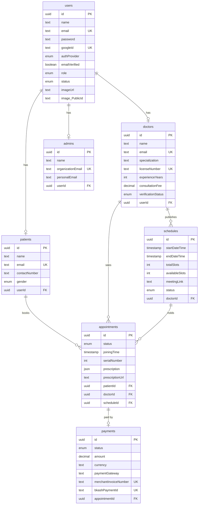

# PH Healthcare — SQL Relations (ERD)

Live diagram: [drawSQL — PH Healthcare System ERD](https://drawsql.app/teams/kazi-ashikur/diagrams/ph-healthcare-system-erd)

This file matches the Prisma schema under `PH Healthcare Management System Backend/prisma/schema/`.

---

## Relationship overview

| From | To | Type | Foreign key | Notes |
| --- | --- | --- | --- | --- |
| `users` | `patients` | **1 : 1** | `patients.userId → users.id` | Cascade delete |
| `users` | `doctors` | **1 : 1** | `doctors.userId → users.id` | Cascade delete |
| `users` | `admins` | **1 : 1** | `admins.userId → users.id` | Cascade delete |
| `doctors` | `schedules` | **1 : N** | `schedules.doctorId → doctors.id` | One doctor, many schedules |
| `patients` | `appointments` | **1 : N** | `appointments.patientId → patients.id` | One patient, many visits |
| `doctors` | `appointments` | **1 : N** | `appointments.doctorId → doctors.id` | One doctor, many visits |
| `schedules` | `appointments` | **1 : N** | `appointments.scheduleId → schedules.id` | One schedule, many bookings |
| `appointments` | `payments` | **1 : 1** | `payments.appointmentId → appointments.id` | One payment per visit |

Prescription data is stored **on** `appointments` (`prescription` JSON + Cloudinary URL fields). There is no separate `prescriptions` table.

---

## Tables and fields

### 1. `users` (User)

| Field | Type | Notes |
| --- | --- | --- |
| `id` | uuid | **PK** |
| `name` | text | |
| `email` | text | Unique |
| `password` | text? | Null for Google-only accounts |
| `googleId` | text? | Unique |
| `authProvider` | enum | `GOOGLE` / `CREDENTIAL` |
| `emailVerified` | boolean | Default `false` |
| `role` | enum | `SUPER_ADMIN` / `ADMIN` / `DOCTOR` / `PATIENT` |
| `status` | enum | `ACTIVE` / `BLOCKED` / `DELETED` |
| `needPasswordChange` | boolean | |
| `imageUrl` | text | Profile photo URL |
| `image_PublicId` | text | Cloudinary public id |
| `isDeleted` | boolean | Soft delete |
| `deletedAt` | timestamp? | |
| `createdAt` | timestamp | |
| `updatedAt` | timestamp | |

Auth lives on this table (`password`, `googleId`, `authProvider`). There is no separate `AUTH` table.

---

### 2. `patients` (Patient)

| Field | Type | Notes |
| --- | --- | --- |
| `id` | uuid | **PK** |
| `name` | text | |
| `email` | text | Unique |
| `contactNumber` | text? | |
| `address` | text? | |
| `gender` | enum? | `MALE` / `FEMALE` / `OTHER` |
| `dateOfBirth` | timestamp? | |
| `bloodGroup` | text? | |
| `medicalHistory` | text? | |
| `isDeleted` | boolean | |
| `deletedAt` | timestamp? | |
| `createdAt` | timestamp | |
| `updatedAt` | timestamp | |
| `userId` | uuid | **FK → users.id** (unique) |

---

### 3. `doctors` (Doctor)

| Field | Type | Notes |
| --- | --- | --- |
| `id` | uuid | **PK** |
| `name` | text | |
| `email` | text | Unique |
| `address` | text? | |
| `specialization` | text | |
| `licenseNumber` | text | Unique |
| `qualifications` | text | |
| `experienceYears` | int | |
| `bio` | text? | |
| `consultationFee` | decimal(10,2)? | |
| `contactNumber` | text? | |
| `verificationStatus` | enum | `PENDING` / `APPROVED` / `REJECTED` |
| `rejectionReason` | text? | |
| `reviewedBy` | text? | Admin user id who reviewed |
| `reviewedAt` | timestamp? | |
| `resume` | text? | Cloudinary URL |
| `resumePublicId` | text? | |
| `additionalFiles` | json? | Extra documents |
| `isDeleted` | boolean | |
| `deletedAt` | timestamp? | |
| `createdAt` | timestamp | |
| `updatedAt` | timestamp | |
| `userId` | uuid | **FK → users.id** (unique) |

---

### 4. `admins` (Admin)

| Field | Type | Notes |
| --- | --- | --- |
| `id` | uuid | **PK** |
| `name` | text | |
| `organizationEmail` | text | Unique (login email) |
| `personalEmail` | text | |
| `contactNumber` | text? | |
| `address` | text? | |
| `isDeleted` | boolean | |
| `deletedAt` | timestamp? | |
| `createdAt` | timestamp | |
| `updatedAt` | timestamp | |
| `userId` | uuid | **FK → users.id** (unique) |

Used for both `ADMIN` and `SUPER_ADMIN` role users.

---

### 5. `schedules` (Schedule)

| Field | Type | Notes |
| --- | --- | --- |
| `id` | uuid | **PK** |
| `startDateTime` | timestamp | Day window start |
| `endDateTime` | timestamp | Day window end |
| `totalSlots` | int | 20-minute slots |
| `availableSlots` | int | Open slots left |
| `meetingLink` | text | Doctor’s Meet / join link |
| `status` | enum | `DRAFT` / `PUBLISHED` |
| `isDeleted` | boolean | |
| `deletedAt` | timestamp? | |
| `createdAt` | timestamp | |
| `updatedAt` | timestamp | |
| `doctorId` | uuid | **FK → doctors.id** |

Unique: `(doctorId, startDateTime, endDateTime)`.

---

### 6. `appointments` (Apppointment)

| Field | Type | Notes |
| --- | --- | --- |
| `id` | uuid | **PK** |
| `status` | enum | `PENDING` / `CONFIRMED` / `BOOKED` / `CANCELLED` / `ONGOING` / `COMPLETED` |
| `joiningTime` | timestamp? | Assigned serial start |
| `serialNumber` | int? | Slot serial after payment |
| `recordUrl` | text? | |
| `recordPublicId` | text? | |
| `prescriptionUrl` | text? | PDF on Cloudinary |
| `prescriptionPublicId` | text? | |
| `prescription` | json? | Findings + medicines |
| `createdAt` | timestamp | |
| `updatedAt` | timestamp | |
| `patientId` | uuid | **FK → patients.id** |
| `doctorId` | uuid | **FK → doctors.id** |
| `scheduleId` | uuid | **FK → schedules.id** |

Unique: `(patientId, doctorId, scheduleId)`  
Unique: `(scheduleId, serialNumber, joiningTime)`

---

### 7. `payments` (Payment)

| Field | Type | Notes |
| --- | --- | --- |
| `id` | uuid | **PK** |
| `status` | enum | `UNPAID` / `PAID` / `FAILED` / `CANCELLED` / `REFUNDED` |
| `amount` | decimal(10,2) | Consultation fee |
| `currency` | text | Default `BDT` |
| `paymentGateway` | text | Default `bkash` |
| `merchantInvoiceNumber` | text | Unique (often appointment id) |
| `bkashPaymentId` | text? | Unique |
| `bkashTrxId` | text? | |
| `payerReference` | text? | Email / phone |
| `paidAt` | text? | |
| `gatewayResponse` | json? | Raw bKash payload |
| `refundTrxId` | text? | |
| `refundAmount` | decimal(10,2)? | |
| `refundReason` | text? | |
| `refundedAt` | text? | |
| `appointmentId` | uuid | **FK → appointments.id** (unique) |
| `createdAt` | timestamp | |
| `updatedAt` | timestamp | |

---

## Enums

| Enum | Values |
| --- | --- |
| `Role` | `SUPER_ADMIN`, `ADMIN`, `DOCTOR`, `PATIENT` |
| `UserStatus` | `ACTIVE`, `BLOCKED`, `DELETED` |
| `AuthProvider` | `GOOGLE`, `CREDENTIAL` |
| `Gender` | `MALE`, `FEMALE`, `OTHER` |
| `DoctorVerificationStatus` | `PENDING`, `APPROVED`, `REJECTED` |
| `ScheduleStatus` | `DRAFT`, `PUBLISHED` |
| `AppointmentStatus` | `PENDING`, `CONFIRMED`, `BOOKED`, `CANCELLED`, `ONGOING`, `COMPLETED` |
| `PaymentStatus` | `UNPAID`, `PAID`, `FAILED`, `CANCELLED`, `REFUNDED` |

---

## Mermaid ER diagram



---

## Visit flow through the relations

```text
users (PATIENT) ──1:1──► patients
users (DOCTOR)  ──1:1──► doctors ──1:N──► schedules (PUBLISHED)
                              │
patients + doctors + schedules ──► appointments (PENDING → BOOKED → …)
                              │
                         appointments ──1:1──► payments (bKash)
                              │
                         prescription JSON + PDF fields on appointments
```

1. A doctor user owns a `doctors` row and creates `schedules`.
2. A patient user owns a `patients` row and books one `appointments` row on a schedule.
3. Payment creates the linked `payments` row; after bKash success the appointment becomes `BOOKED` and gets `serialNumber` / `joiningTime`.
4. After `COMPLETED`, the doctor writes prescription data onto that same appointment.
